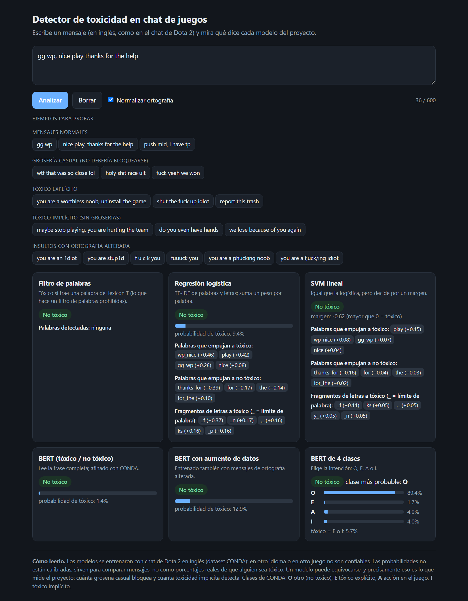
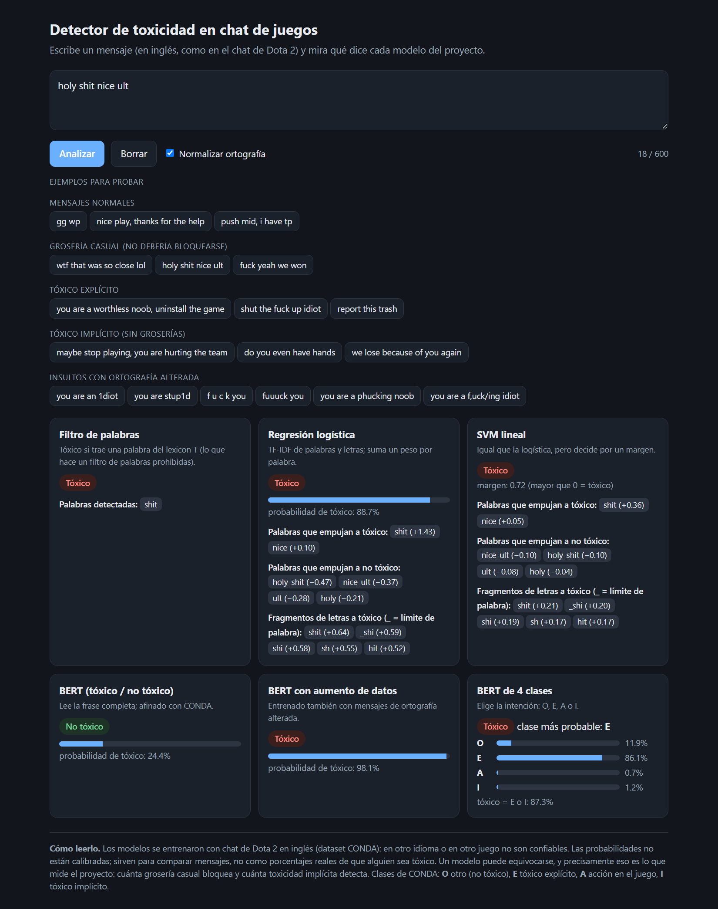
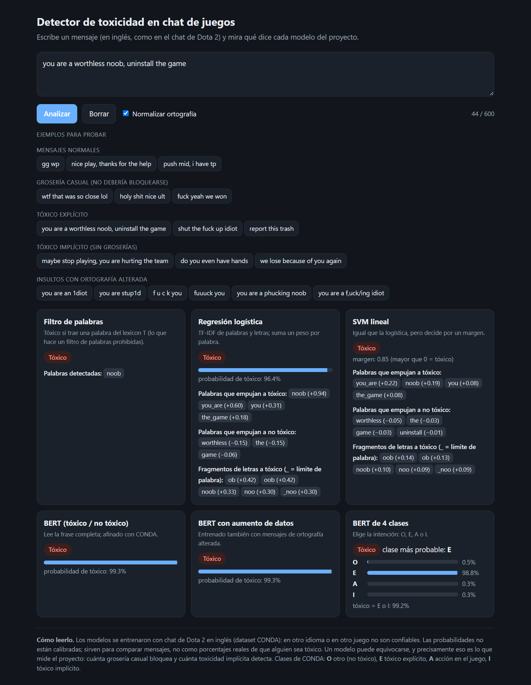
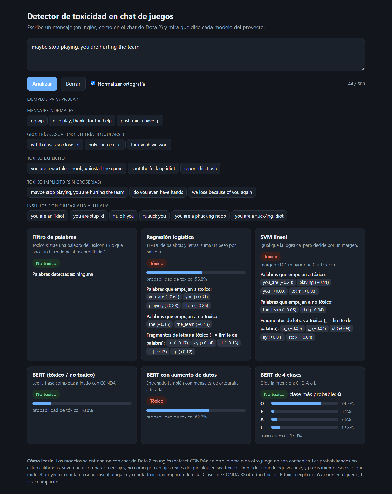
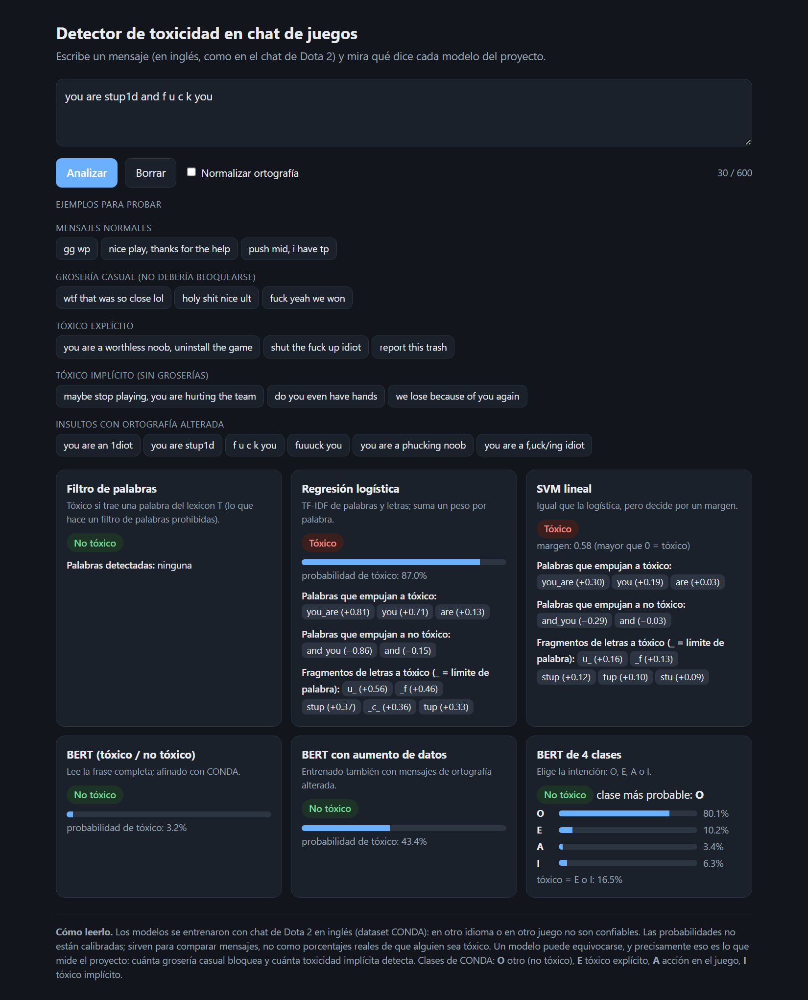
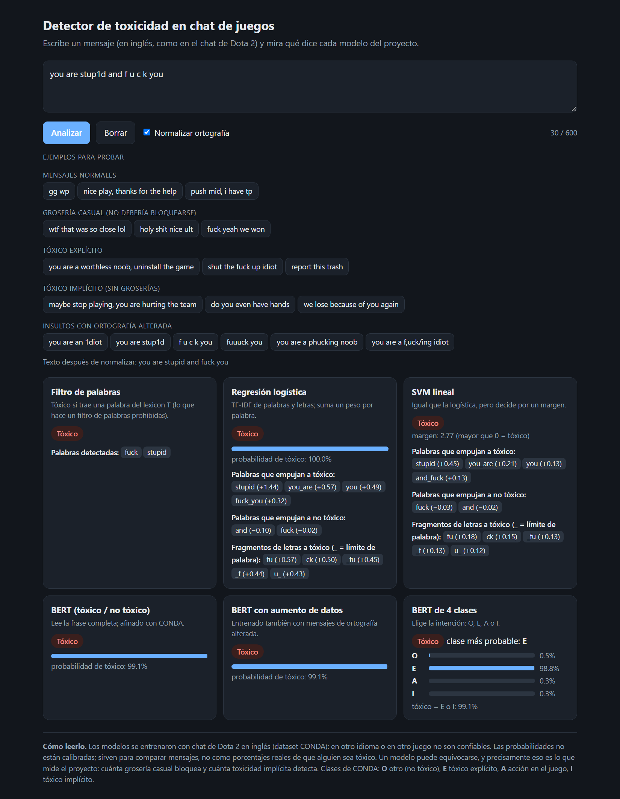
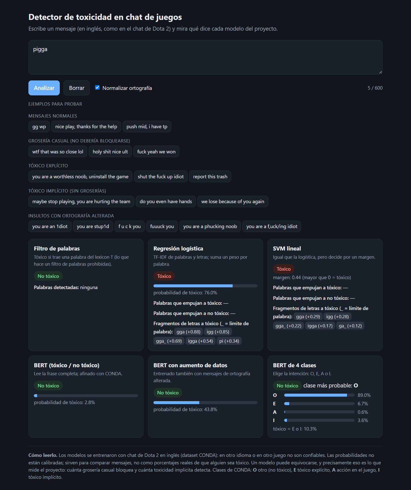

# Demo: escribe un mensaje y mira qué dice cada modelo

Una página local (solo en tu computadora, `http://127.0.0.1:8765`) con un cuadro de texto. Al enviar un mensaje muestra el veredicto de los modelos de CONDA que se evaluaron en `../RESULTADOS.md`:

| Modelo | Qué muestra |
|---|---|
| Filtro de palabras | Si el mensaje trae una palabra del lexicon T, y cuál. |
| Regresión logística | Probabilidad de tóxico, y las palabras y fragmentos de letras que más pesaron. |
| SVM lineal | Margen de decisión (mayor que 0 = tóxico) y lo que más pesó. |
| BERT (tóxico / no tóxico) | Probabilidad de tóxico. |
| BERT de 4 clases | Probabilidad de O, E, A e I (tóxico = E o I). |
| BERT con aumento de datos | Igual que el BERT binario, pero entrenado también con mensajes de ortografía alterada (aparece si existe `modelos/bert_robusto.pt`, que crea `12_robustez.py`). |

## Cómo usarla

Desde la raíz del repo:

```
python Proyecto/Modelado/10_entrenar_demo.py    # una sola vez (~12 min con GPU): entrena y guarda los modelos aquí en Demo/modelos/
python Proyecto/Modelado/12_robustez.py         # opcional: entrena el BERT con aumento y mide la robustez (~25 min con GPU)
python Proyecto/Modelado/11_demo.py             # arranca la demo; abre el navegador solo
```

- `11_demo.py --sin-bert` arranca en segundos con el filtro, la logística y el SVM, sin cargar BERT.
- `11_demo.py --puerto 9000` usa otro puerto si el 8765 está ocupado.
- Ctrl+C en la terminal cierra la demo.

La carpeta `modelos/` (unos 420 MB) no está en git: se genera con `10_entrenar_demo.py`.

## Qué esperar (y qué no)

- Los modelos se entrenaron con **chat de Dota 2 en inglés**. En otro idioma o en otro juego no son confiables.
- Las probabilidades **no están calibradas**: sirven para comparar mensajes, no como porcentajes reales.
- Es una demostración, no una evaluación: unos cuantos mensajes escritos a mano no prueban nada en términos estadísticos. Las métricas del proyecto están en `../RESULTADOS.md`.
- **Casilla "Normalizar ortografía"** (activada por defecto): antes de pasar el mensaje a los modelos deshace disfraces como `1diot`, `f u c k`, `fuuuck` o `phuck`, y muestra el texto ya corregido. Apágala para ver cómo responden los modelos al texto tal cual: sin normalizar, el filtro de palabras casi no detecta insultos disfrazados y BERT detecta pocos. La medición completa está en `../RESULTADOS.md`, sección 8.
- Los modelos fallan, y eso es parte del hallazgo. La normalización solo cubre los disfraces que sus reglas conocen: con alteraciones raras (`f,uck/ing`) sigue fallando.

## Capturas de la demo funcionando

Siete capturas reales de la demo (`11_demo.py`) con los modelos entrenados, tomadas con Chrome sin ventana sobre el sistema en marcha. Los números de la tabla salen de la propia demo (probabilidad de tóxico, salvo el SVM, que da un margen: mayor que 0 = tóxico).

| Captura | Mensaje | Filtro | Logística | SVM | BERT | BERT con aumento | BERT 4 clases |
|---|---|---|---|---|---|---|---|
| [01](capturas/01_mensaje_normal.png) | `gg wp, nice play thanks for the help` | no tóxico | 9% | -0.62 | 1% | 13% | O (6% tóxico) |
| [02](capturas/02_groseria_casual.png) | `holy shit nice ult` | tóxico | 89% | +0.72 | 24% | 98% | E (87% tóxico) |
| [03](capturas/03_toxico_explicito.png) | `you are a worthless noob, uninstall the game` | tóxico | 96% | +0.85 | 99% | 99% | E (99% tóxico) |
| [04](capturas/04_toxico_implicito.png) | `maybe stop playing, you are hurting the team` | no tóxico | 56% | +0.01 | 19% | 63% | O (18% tóxico) |
| [05](capturas/05_disfraz_sin_normalizar.png) | `you are stup1d and f u c k you` (sin normalizar) | no tóxico | 87% | +0.58 | 3% | 43% | O (17% tóxico) |
| [06](capturas/06_disfraz_con_normalizar.png) | `you are stup1d and f u c k you` | tóxico | 100% | +2.77 | 99% | 99% | E (99% tóxico) |
| [07](capturas/07_limite_pigga.png) | `pigga` | no tóxico | 76% | +0.44 | 3% | 44% | O (10% tóxico) |

### Mensaje normal

Un mensaje normal: ningún modelo debería marcarlo.



### Grosería casual (no debería bloquearse)

Una grosería dicha con buena onda. Aquí se ve el problema central del proyecto: el filtro y varios modelos la bloquean.



### Tóxico explícito

Un ataque directo: debería marcarse.



### Tóxico implícito (sin groserías)

Tóxico sin ninguna grosería: lo que un filtro de palabras no puede ver.



### Insulto disfrazado, SIN normalizar

El mismo mensaje con la casilla de normalización apagada: los modelos se confunden con las letras cambiadas.



### Insulto disfrazado, CON normalizar

El mismo mensaje con la normalización activada: el texto se corrige a `you are stupid and fuck you` antes de los modelos. Texto normalizado: `you are stupid and fuck you`.



### El límite: un disfraz que ninguna regla conoce

Una variante escrita de un insulto racista que el normalizador no reconoce: casi todos los modelos la dejan pasar. Es el límite que se documenta en `RESULTADOS.md`, sección 8.


