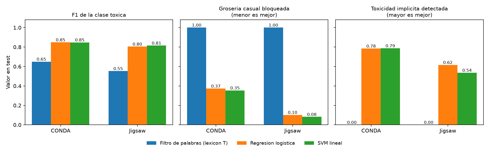

# Resultados del modelado

**Estado: entrega del 28 de octubre** (filtro de palabras, regresión logística y SVM lineal, por fuente). Los modelos de la entrega del 4 de noviembre (BiGRU/LSTM, BERT/RoBERTa, contexto y transferencia) se agregarán a este archivo.

Todo se reproduce con `python Proyecto/Modelado/01_baseline_y_lineales.py` desde la raíz del repo. Las cifras salen de `Resultados/resultados_lineales.csv`.

## 1. Cómo se hizo

| Decisión | Qué se hizo |
|---|---|
| Datos y etiqueta | `Unificado/dataset_unificado.csv.gz`, con la etiqueta común `is_toxic` (ver `DECISIONES.md`). Un modelo **por fuente**. |
| Split en CONDA | Se juntan el train y valid oficiales (35,887 mensajes) y se re-parten **por partida** (`group_id` = `matchId`) 80/20: 28,318 en train y 7,569 en test. El script comprueba que ninguna partida esté en ambos. |
| Split en Jigsaw | El valid estratificado del preprocesamiento: 119,679 en train y 39,892 en test. |
| Filtro de palabras | Marca como tóxico todo mensaje con al menos una palabra del lexicon T. Las palabras son secuencias `[a-z0-9_']+` en minúsculas. |
| Rasgos | TF-IDF de palabras (1-2 gramas, máx. 200,000) y de caracteres (2-4 gramas dentro de palabras, máx. 150,000), ajustado solo con train. |
| Modelos | Regresión logística (`liblinear`) y SVM lineal (`LinearSVC`), ambos con `class_weight="balanced"`. |
| Hiperparámetro | C ∈ {0.3, 1, 3}, elegido por F1 de la clase tóxica en un dev del 20% de train (por partida en CONDA). C final: logística 3.0 en ambas fuentes; SVM 0.3 en CONDA y 1.0 en Jigsaw. |
| Semilla | 42. El test no se usó para elegir nada. |

## 2. Resultados en test

| Fuente | Modelo | F1 macro | F1 tóxico | Recall tóxico | AUC-PR | Grosería casual bloqueada | Toxicidad implícita detectada |
|---|---|---|---|---|---|---|---|
| CONDA | Filtro de palabras (lexicon T) | 0.789 | 0.650 | 0.548 | 0.545 | 1.000 | 0.000 |
| CONDA | Regresión logística | 0.904 | 0.848 | 0.882 | 0.924 | 0.373 | 0.784 |
| CONDA | SVM lineal | 0.904 | 0.848 | 0.881 | 0.921 | 0.354 | 0.787 |
| Jigsaw | Filtro de palabras (lexicon T) | 0.740 | 0.553 | 0.758 | 0.428 | 1.000 | 0.000 |
| Jigsaw | Regresión logística | 0.891 | 0.805 | 0.846 | 0.905 | 0.102 | 0.616 |
| Jigsaw | SVM lineal | 0.897 | 0.815 | 0.810 | 0.899 | 0.082 | 0.536 |

- Las dos tasas se calculan sobre dos grupos del test (definidos en `comun.py`):
  - **Grosería casual:** mensajes con alguna palabra del lexicon T y etiquetados **no** tóxicos. Es mejor que el modelo los deje pasar.
  - **Toxicidad implícita:** mensajes tóxicos **sin** ninguna palabra del lexicon T. Es mejor que el modelo los detecte.
- "Grosería casual bloqueada" es el porcentaje del primer grupo que el modelo marca como tóxico (menor es mejor). "Toxicidad implícita detectada" es el porcentaje del segundo grupo que marca como tóxico (mayor es mejor).
- El AUC-PR del filtro usa el número de palabras del lexicon como puntaje, porque no tiene probabilidades.

### Las dos tasas con su incertidumbre

Los grupos de CONDA son chicos (212 y 695 mensajes en test), así que las tasas tienen intervalos amplios. Intervalo de confianza de 95% (Wilson):

| Fuente | Modelo | Grosería casual bloqueada | Toxicidad implícita detectada |
|---|---|---|---|
| CONDA | Logística | 0.373 [0.31, 0.44] | 0.784 [0.75, 0.81] |
| CONDA | SVM | 0.354 [0.29, 0.42] | 0.787 [0.76, 0.82] |
| Jigsaw | Logística | 0.102 [0.09, 0.11] | 0.616 [0.59, 0.65] |
| Jigsaw | SVM | 0.082 [0.07, 0.09] | 0.536 [0.50, 0.57] |

## 3. Qué salió

1. **Los dos modelos superan al filtro de palabras en las dos fuentes.** El F1 tóxico sube de 0.650 a 0.848 en CONDA y de 0.553 a 0.805 (logística) o 0.815 (SVM) en Jigsaw. Coincide con lo esperado en el README (≈ 0.84 y 0.81 con logística, ≈ 0.65 y 0.55 con el filtro).
2. **El 1.000 y el 0.000 del filtro no son un hallazgo, son consecuencia de cómo se definen los grupos.** Un grupo se define por tener palabra del lexicon y el otro por no tenerla, y el filtro decide solo por eso. Sirven como punto de referencia: es lo que hace un filtro de palabras prohibidas.
3. **En CONDA los modelos detectan la mayor parte de la toxicidad implícita (≈ 78-79%), pero siguen bloqueando una parte importante de la grosería casual (35-37%).** Mejoran mucho frente al filtro, que bloquea todo, pero todavía no dejan pasar las groserías casuales. Una explicación probable es que TF-IDF aprende palabras como "wtf" o "fuck" como señal fuerte de toxicidad; **no está probado**. En el grupo casual de CONDA las palabras más frecuentes son "wtf" (281 mensajes), "dead" (78), "fuck" (67) y "hook" (53).
4. **El grupo "grosería casual" de Jigsaw no mide lo mismo que en CONDA.** El lexicon T sale de chat de Dota 2 e incluye palabras como "period", "black", "german" o "abuse", que en comentarios de Wikipedia son normales. Por eso ese grupo tiene 15,962 comentarios en todo Jigsaw y su tasa mide falsos positivos del lexicon sobre otro tipo de texto, no groserías casuales. Para la pregunta del artículo, la comparación válida es la de **CONDA**.
5. **No hay un ganador claro entre logística y SVM.** En CONDA son prácticamente iguales (F1 tóxico 0.848 y 0.848). En Jigsaw el SVM tiene mayor F1 tóxico (0.815 contra 0.805) pero la logística detecta más toxicidad implícita (0.616 contra 0.536), porque el SVM es más conservador (precisión 0.820 contra 0.767, recall 0.810 contra 0.846). Es una sola partición con una semilla, así que estas diferencias no se pueden dar por firmes.

## 4. Limitaciones

- **Texto repetido entre train y test en CONDA:** 35.0% de los mensajes del test (2,652 de 7,569) tienen un texto idéntico en train, sobre todo "gg" (366), "lol" (187), "ez" (102) y "ggwp" (94). El split por partida evita mezclar partidas, pero no esto, y puede hacer las métricas de CONDA algo optimistas. En Jigsaw es 0.2% (99 de 39,892). Un siguiente paso es reportar las métricas también sobre los mensajes cuyo texto no aparece en train.
- **Una sola partición y una semilla.** Las métricas no traen intervalo de confianza. Las tasas de CONDA sí lo traen y es amplio.
- **C quedó en el borde de la malla** en la logística (3.0 en ambas fuentes) y en el SVM de CONDA (0.3). El óptimo podría estar fuera de la malla.
- **Conteo del lexicon:** con mi regla de coincidencia, el grupo de grosería casual en todo CONDA (train + valid) tiene 1,070 mensajes, igual que el README. El de toxicidad implícita tiene 3,186 y el README dice 3,182. Una regla de tokenización distinta da 3,182 pero cambia el primer grupo a 1,072; no encontré una que coincida con ambos.
- **Mayúsculas:** TF-IDF pasa todo a minúsculas, aunque `DECISIONES.md` menciona que las mayúsculas pueden ser señal.
- **Aún no se reportan las 4 clases de CONDA** (E, I, A, O) para compararse con la Tabla 5 de Weld et al. (Joint BERT: E 0.872, I 0.768, A 0.800, O 0.954). Se hará con los modelos del 4 de noviembre.

## 5. Archivos

| Archivo | Contenido |
|---|---|
| `comun.py` | Carga de datos, lexicon, splits y métricas. |
| `01_baseline_y_lineales.py` | Entrena y evalúa. Tarda unos 21 minutos, casi todo en Jigsaw. Con `--solo-tablas` regenera la tabla y la gráfica desde el CSV sin reentrenar. |
| `Resultados/resultados_lineales.csv` | Todas las métricas, incluida la exactitud, la precisión y el tamaño de los grupos. |
| `Resultados/resultados_lineales.md` | Tabla generada por el script. |
| `Resultados/tasas_lineales.png` | Gráfica de F1 tóxico y las dos tasas. |
