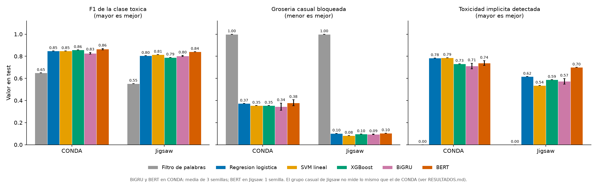
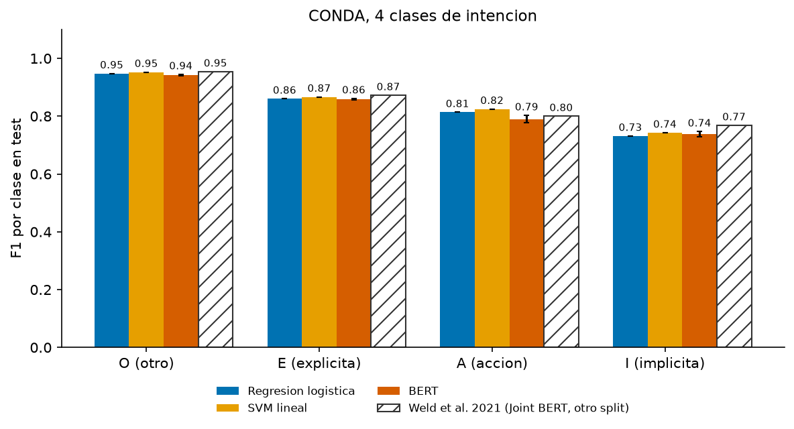
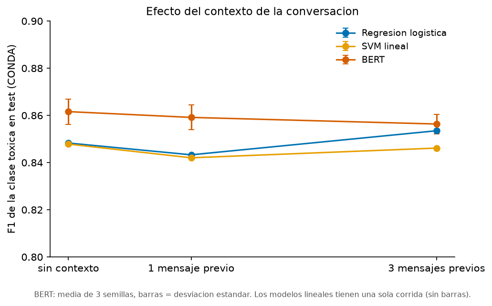
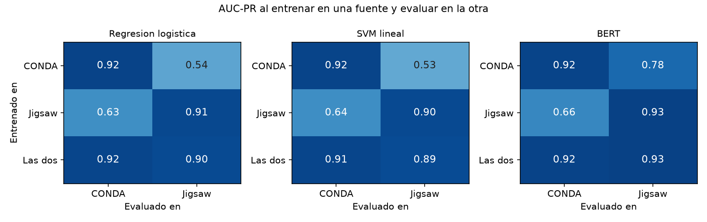
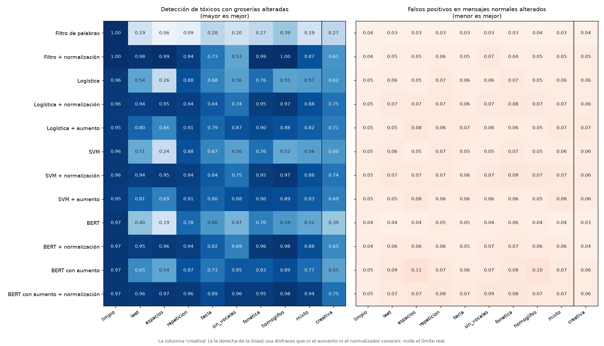

# Resultados del modelado

**Estado:** entregas del 28 de octubre y del 4 de noviembre completas: filtro de palabras, regresión logística, SVM lineal, XGBoost, BiGRU y BERT por fuente; las 4 clases de CONDA; el experimento de contexto; y el de transferencia entre fuentes. No se probó RoBERTa (el README pide "BERT o RoBERTa"; se usó BERT).

Todo se reproduce desde la raíz del repo con los scripts de `Proyecto/Modelado/` (ver la sección 10), pero **correrlos es opcional**: las cifras y figuras ya están guardadas en `Resultados/` y los modelos de la demo ya vienen entrenados en el repo (con Git LFS). Las cifras salen de los CSV de `Resultados/`, y `Resultados/Reporte_de_resultados.pdf` es este mismo documento con sus figuras.

## 0. Respuesta corta a las tres preguntas del artículo

1. **¿Cuánto mejora cada modelo sobre el filtro de palabras en los dos grupos?** Mucho. En CONDA el F1 de la clase tóxica pasa de 0.650 (filtro) a 0.83-0.87 (modelos entrenados). La toxicidad implícita detectada pasa de 0 a 0.71-0.79. La grosería casual bloqueada baja de 1.00 a 0.34-0.38: **los modelos dejan pasar la mayor parte de la grosería casual, pero todavía bloquean entre un tercio y dos quintos**. BERT tiene el mejor F1 (0.865), pero **no** es el mejor en las dos tasas: la toxicidad implícita detectada es mayor con la logística y el SVM (0.78-0.79 contra 0.74).
2. **¿Ayudan los mensajes anteriores de la partida?** **No, en nuestros datos.** Con BERT (3 semillas) el F1 tóxico en CONDA es 0.862 ± 0.005 sin contexto, 0.859 ± 0.005 con 1 mensaje previo y 0.856 ± 0.004 con 3; con los modelos lineales tampoco hay una mejora clara. Coincide con lo que dice Pavlopoulos 2020 y no con ToxBuster (Yang 2023).
3. **¿Conviene un modelo por fuente o uno con las dos juntas?** Entrenar en una fuente y evaluar en la otra **cae mucho** (F1 tóxico de 0.87 a 0.64 con BERT de CONDA a Jigsaw, y de 0.84 a 0.58 de Jigsaw a CONDA; con los lineales, de 0.85 a 0.28 de CONDA a Jigsaw). Un modelo conjunto **no mejora** a los de cada fuente: con BERT queda igual (0.856 y 0.841 contra 0.866 y 0.844) y con los modelos lineales queda algo peor en CONDA.

**Extra: ¿y si se disfrazan las groserías (`1diot`, `f u c k`)?** Sin remedios, BERT pasa de detectar el 97% a entre 19% y 78%. Normalizar el texto antes de los modelos lo sube a 94% a 98% en cinco de las nueve familias probadas sin reentrenar, y combinarlo con entrenamiento aumentado lleva a 89% a 98% en las ocho familias conocidas y a 75% en la que no se ve (sección 8), a cambio de 1 a 5 puntos más de falsos positivos.

Todas las respuestas tienen las limitaciones de la sección 9: una sola partición y, en la transferencia y en BERT sobre Jigsaw, una sola semilla.

## 1. Cómo se hizo

| Decisión | Qué se hizo |
|---|---|
| Datos y etiqueta | `Unificado/dataset_unificado.csv.gz`, con la etiqueta común `is_toxic` (ver `DECISIONES.md`). Un modelo **por fuente**, salvo en el experimento de transferencia. |
| Split en CONDA | Se juntan el train y valid oficiales (35,887 mensajes) y se re-parten **por partida** (`group_id` = `matchId`) 80/20: 28,318 en train y 7,569 en test. El script comprueba que ninguna partida esté en ambos. |
| Split en Jigsaw | El valid estratificado del preprocesamiento: 119,679 en train y 39,892 en test. |
| Filtro de palabras | Marca como tóxico todo mensaje con al menos una palabra del lexicon T. Las palabras son secuencias `[a-z0-9_']+` en minúsculas. |
| Rasgos | TF-IDF de palabras (1-2 gramas, máx. 200,000) y de caracteres (2-4 gramas dentro de palabras, máx. 150,000), ajustado solo con train. |
| Modelos lineales | Regresión logística (`liblinear`) y SVM lineal (`LinearSVC`), ambos con `class_weight="balanced"`. C ∈ {0.3, 1, 3}, elegido por F1 de la clase tóxica en un dev del 20% de train (por partida en CONDA). C final: logística 3.0 en ambas fuentes; SVM 0.3 en CONDA y 1.0 en Jigsaw. Se reajustan con todo train. Semilla 42. |
| XGBoost | Sobre los mismos rasgos TF-IDF en CONDA; **en Jigsaw se usaron 50,000 rasgos** (30,000 de palabras y 20,000 de caracteres) porque con los 350,000 no terminó en más de una hora (sección 7). Hasta 600 árboles de profundidad 6, tasa de aprendizaje 0.1, 50% de rasgos por árbol, peso de clase balanceado. Se entrena con el 80% de train y el dev del 20% decide cuántos árboles dejar (parada temprana por AUC-PR). Una sola configuración, sin ajuste. |
| BiGRU | Embeddings de 128 entrenados desde cero, GRU bidireccional de 128 unidades, concatenación de max y media sobre la secuencia, dropout 0.3. Vocabulario de hasta 50,000 palabras. Longitud máxima: 40 tokens en CONDA y 200 en Jigsaw. AdamW (lr 2e-3, lote de 256), `pos_weight` para la clase tóxica, hasta 10 épocas con parada temprana en el dev. Se entrena con el 80% de train. Semillas 42, 43 y 44. |
| BERT | `bert-base-uncased` afinado completo con una capa de clasificación. Longitud máxima: 64 tokens en CONDA y 128 en Jigsaw. AdamW (lr 2e-5, lote de 32, calentamiento 10%), peso de clase balanceado, precisión mixta fp16, 3 épocas en CONDA y 2 en Jigsaw, y se conserva la época con mejor F1 en el dev. Se entrena con el 80% de train. Semillas 42, 43 y 44 en CONDA; **solo la 42 en Jigsaw**. Una sola configuración, sin ajuste. |
| 4 clases de CONDA | Las clases O, E, A e I (`intentClass`). Lineales con uno-contra-resto y C elegido por F1 macro en el dev; BERT con 4 salidas y peso de clase balanceado, 3 épocas, 3 semillas. Para las dos tasas y el F1 tóxico, la predicción se convierte a binaria (tóxico = E o I). |
| Contexto | Solo CONDA. Se agregan al mensaje los **k mensajes anteriores de la misma conversación** (`conversationId`, ordenados por `chatTime`; k = 0, 1 y 3), del más viejo al más nuevo. En BERT van como primer segmento (`[CLS] contexto [SEP] mensaje [SEP]`) y el mensaje nunca se recorta; en los lineales se suma un TF-IDF de palabras del contexto. El 73.5% de los mensajes del test (5,565 de 7,569) tiene al menos un mensaje previo. El contexto se arma con los tres archivos originales de CONDA, pero nunca cruza partidas, así que no hay fuga entre train y test. |
| Transferencia | Tres entrenamientos (solo CONDA, solo Jigsaw y las dos fuentes juntas, con sus dev combinados) evaluados en los dos tests. Lineales con C elegido en el dev; BERT con una sola semilla (42) y longitud máxima 128 en todos los casos. |
| Hardware | RTX 4050 portátil de 6 GB. Varias corridas de BERT se cayeron por errores intermitentes de la GPU (memoria y cuBLAS) y se repitieron desde cero con la misma semilla; para evitarlo, las últimas corridas rellenan cada lote a un múltiplo de 8 (relleno enmascarado, que no cambia el modelo). |

## 2. Resultados en test, por fuente

| Fuente | Modelo | F1 macro | F1 tóxico | Recall tóxico | AUC-PR | Grosería casual bloqueada | Toxicidad implícita detectada |
|---|---|---|---|---|---|---|---|
| CONDA | Filtro de palabras (lexicon T) | 0.789 | 0.650 | 0.548 | 0.545 | 1.000 | 0.000 |
| CONDA | Regresión logística | 0.904 | 0.848 | 0.882 | 0.924 | 0.373 | 0.784 |
| CONDA | SVM lineal | 0.904 | 0.848 | 0.881 | 0.921 | 0.354 | 0.787 |
| CONDA | XGBoost | 0.911 | 0.858 | 0.857 | 0.921 | 0.354 | 0.732 |
| CONDA | BiGRU (media ± desv., 3 semillas) | 0.891 ± 0.006 | 0.827 ± 0.008 | 0.828 ± 0.018 | 0.900 ± 0.005 | 0.344 ± 0.033 | 0.712 ± 0.025 |
| CONDA | BERT (media ± desv., 3 semillas) | 0.915 ± 0.004 | 0.865 ± 0.006 | 0.865 ± 0.011 | 0.910 ± 0.018 | 0.379 ± 0.027 | 0.739 ± 0.022 |
| Jigsaw | Filtro de palabras (lexicon T) | 0.740 | 0.553 | 0.758 | 0.428 | 1.000 | 0.000 |
| Jigsaw | Regresión logística | 0.891 | 0.805 | 0.846 | 0.905 | 0.102 | 0.616 |
| Jigsaw | SVM lineal | 0.897 | 0.815 | 0.810 | 0.899 | 0.082 | 0.536 |
| Jigsaw | XGBoost (50,000 rasgos, ver sección 7) | 0.882 | 0.790 | 0.828 | 0.886 | 0.096 | 0.588 |
| Jigsaw | BiGRU (media ± desv., 3 semillas) | 0.890 ± 0.003 | 0.803 ± 0.005 | 0.834 ± 0.007 | 0.894 ± 0.002 | 0.094 ± 0.002 | 0.573 ± 0.025 |
| Jigsaw | BERT (1 semilla) | 0.911 | 0.841 | 0.885 | 0.932 | 0.105 | 0.700 |

- Las dos tasas se calculan sobre dos grupos del test (definidos en `comun.py`):
  - **Grosería casual:** mensajes con alguna palabra del lexicon T y etiquetados **no** tóxicos. Es mejor que el modelo los deje pasar.
  - **Toxicidad implícita:** mensajes tóxicos **sin** ninguna palabra del lexicon T. Es mejor que el modelo los detecte.
- "Grosería casual bloqueada" es el porcentaje del primer grupo que el modelo marca como tóxico (menor es mejor). "Toxicidad implícita detectada" es el porcentaje del segundo grupo que marca como tóxico (mayor es mejor).
- El AUC-PR del filtro usa el número de palabras del lexicon como puntaje, porque no tiene probabilidades.

### Las dos tasas con su incertidumbre

Los grupos de CONDA son chicos (212 y 695 mensajes en test), así que las tasas tienen intervalos amplios. Intervalo de confianza de 95% (Wilson) para los modelos lineales:

| Fuente | Modelo | Grosería casual bloqueada | Toxicidad implícita detectada |
|---|---|---|---|
| CONDA | Logística | 0.373 [0.31, 0.44] | 0.784 [0.75, 0.81] |
| CONDA | SVM | 0.354 [0.29, 0.42] | 0.787 [0.76, 0.82] |
| Jigsaw | Logística | 0.102 [0.09, 0.11] | 0.616 [0.59, 0.65] |
| Jigsaw | SVM | 0.082 [0.07, 0.09] | 0.536 [0.50, 0.57] |

## 3. Qué salió

1. **Los modelos entrenados superan al filtro de palabras en las dos fuentes.** El F1 tóxico sube de 0.650 a 0.83-0.87 en CONDA y de 0.553 a 0.79-0.84 en Jigsaw. Coincide con lo esperado en el README (≈ 0.84 y 0.81 con logística, ≈ 0.65 y 0.55 con el filtro).
2. **El 1.000 y el 0.000 del filtro no son un hallazgo, son consecuencia de cómo se definen los grupos.** Un grupo se define por tener palabra del lexicon y el otro por no tenerla, y el filtro decide solo por eso. Sirven como punto de referencia: es lo que hace un filtro de palabras prohibidas.
3. **En CONDA los modelos detectan la mayor parte de la toxicidad implícita (0.71-0.79), pero siguen bloqueando una parte importante de la grosería casual (0.34-0.38).** Mejoran mucho frente al filtro, que bloquea todo, pero no dejan pasar las groserías casuales. Una explicación probable es que los modelos aprenden palabras como "wtf" o "fuck" como señal fuerte de toxicidad; **no está probado**. En el grupo casual de CONDA las palabras más frecuentes son "wtf" (281 mensajes), "dead" (78), "fuck" (67) y "hook" (53).
4. **El grupo "grosería casual" de Jigsaw no mide lo mismo que en CONDA.** El lexicon T sale de chat de Dota 2 e incluye palabras como "period", "black", "german" o "abuse", que en comentarios de Wikipedia son normales. Por eso ese grupo tiene 15,962 comentarios en todo Jigsaw y su tasa mide falsos positivos del lexicon sobre otro tipo de texto, no groserías casuales. Para la pregunta del artículo, la comparación válida es la de **CONDA**.
5. **No hay un ganador claro entre logística y SVM.** En CONDA son prácticamente iguales (F1 tóxico 0.848 y 0.848). En Jigsaw el SVM tiene mayor F1 tóxico (0.815 contra 0.805) pero la logística detecta más toxicidad implícita (0.616 contra 0.536), porque el SVM es más conservador (precisión 0.820 contra 0.767, recall 0.810 contra 0.846).
6. **El BiGRU no supera a los modelos lineales.** En CONDA su F1 tóxico es 0.827 ± 0.008 contra 0.848 de la logística y del SVM (la diferencia, 0.021, es de unas 2.5 desviaciones estándar entre semillas). En Jigsaw (0.803 ± 0.005) queda a la par de la logística (0.805). Donde más pierde es en la toxicidad implícita de CONDA (0.712 contra 0.784-0.787). Una parte de la diferencia puede venir de que el BiGRU ve solo el 80% de train; **no se probó** reentrenarlo con todo train.
7. **BERT es el mejor en F1 tóxico en las dos fuentes, pero no mejora las dos tasas del artículo en CONDA.**
   - **F1 tóxico:** en CONDA 0.865 ± 0.006 contra 0.848 de los lineales y 0.827 del BiGRU; en Jigsaw 0.841 contra 0.805-0.815.
   - **Toxicidad implícita detectada:** en CONDA, BERT detecta 0.739 ± 0.022, **menos** que la logística y el SVM (0.784 y 0.787) y más que el BiGRU (0.712). En Jigsaw sí mejora (0.700 contra 0.536-0.616).
   - **Grosería casual bloqueada:** en CONDA, BERT bloquea 0.379 ± 0.027, igual o algo más que los lineales (0.354-0.373), así que **no deja pasar mejor la grosería casual**. Con una desviación de 0.027 entre semillas y un grupo de solo 212 mensajes, esas diferencias no son firmes.
   - **AUC-PR en CONDA:** 0.910 ± 0.018, **por debajo** de los lineales (0.921-0.924) aunque su F1 sea mayor. BERT no ordena mejor los mensajes por probabilidad de ser tóxicos; la mejora de F1 viene de una mejor precisión con un punto de operación distinto (precisión 0.865 contra 0.817 de los lineales, con recall algo menor: 0.865 contra 0.882). Las tasas de los grupos también dependen de ese umbral, que no se ajustó.
8. **XGBoost queda entre los lineales y BERT en CONDA.** Su F1 tóxico (0.858) supera a los lineales (0.848) y no llega a BERT (0.865); detecta menos toxicidad implícita (0.732 contra 0.784-0.787 de los lineales) y bloquea la misma grosería casual que el SVM (0.354). Los árboles sobre TF-IDF no mejoran lo que más nos importa. En Jigsaw, con solo 50,000 rasgos (ver sección 7), su F1 tóxico es 0.790, por debajo de los lineales (0.805-0.815), del BiGRU (0.803) y de BERT (0.841). Llegó a 598 de los 600 árboles permitidos sin que la validación dejara de mejorar, así que con más árboles podría subir; **no se probó**. Detecta 0.588 de la toxicidad implícita (entre el SVM, 0.536, y la logística, 0.616) y bloquea 0.096 de la grosería casual, igual que los demás.

## 4. Las 4 clases de CONDA

Comparación con la Tabla 5 de Weld et al. 2021 (Joint BERT). Nuestro split es distinto (por partida, 80/20), así que **la comparación con Weld es aproximada**.

| Modelo | F1 O | F1 E | F1 A | F1 I | F1 macro (4 clases) | Exactitud | F1 tóxico (E o I) | Grosería casual bloqueada | Toxicidad implícita detectada |
|---|---|---|---|---|---|---|---|---|---|
| Regresión logística | 0.948 | 0.860 | 0.814 | 0.731 | 0.838 | 0.911 | 0.854 | 0.330 | 0.780 |
| SVM lineal | 0.952 | 0.867 | 0.825 | 0.743 | 0.847 | 0.918 | 0.861 | 0.302 | 0.745 |
| BERT (media ± desv., 3 semillas) | 0.942 ± 0.002 | 0.858 ± 0.003 | 0.790 ± 0.013 | 0.737 ± 0.009 | 0.832 ± 0.001 | 0.905 ± 0.002 | 0.848 ± 0.003 | 0.414 ± 0.027 | 0.776 ± 0.036 |
| Weld et al. 2021, Joint BERT (otro split) | 0.954 | 0.872 | 0.800 | 0.768 | | 0.921 | | | |

- **La clase I (toxicidad implícita) es la más difícil para todos los modelos** (F1 de 0.73 a 0.74), igual que en Weld (0.768). La A (acción) y la E (explícita) salen mejor, y la O (no tóxico) es la más fácil.
- **BERT no mejora a los modelos lineales en las 4 clases.** Su F1 macro (0.832) queda por debajo del SVM (0.847) y de la logística (0.838), y en la clase I la logística (0.731) y el SVM (0.743) quedan a menos de una desviación estándar de BERT (0.737 ± 0.009), o sea que no se distinguen. El README esperaba que BERT mejorara la clase I; **no se observa** en nuestro split.
- **Frente a Weld**, nuestros modelos quedan por debajo en E (0.858-0.867 contra 0.872), en I (0.731-0.743 contra 0.768) y en exactitud (0.905-0.918 contra 0.921), y por encima o igual en A con los lineales (0.814-0.825 contra 0.800). No se puede atribuir la diferencia solo al modelo: el split y el test son otros, y el Joint BERT de Weld usa además las etiquetas por palabra.
- **Entrenar con 4 clases no ayuda a la tarea binaria.** El F1 tóxico derivado (E o I) de BERT con 4 clases (0.848) queda por debajo del BERT entrenado directamente en binario (0.865). Con 4 clases, los lineales bloquean menos grosería casual (0.302-0.330) que los entrenados en binario (0.354-0.373), pero con una incertidumbre grande (212 mensajes).

## 5. ¿Ayuda el contexto de la conversación?

| Modelo | Mensajes previos (k) | F1 tóxico | Recall tóxico | AUC-PR | Grosería casual bloqueada | Toxicidad implícita detectada | F1 tóxico solo en mensajes con contexto |
|---|---|---|---|---|---|---|---|
| Regresión logística | 0 | 0.848 | 0.882 | 0.924 | 0.373 | 0.784 | 0.843 |
| Regresión logística | 1 | 0.843 | 0.872 | 0.923 | 0.373 | 0.776 | 0.835 |
| Regresión logística | 3 | 0.854 | 0.872 | 0.924 | 0.349 | 0.770 | 0.850 |
| SVM lineal | 0 | 0.848 | 0.881 | 0.921 | 0.354 | 0.787 | 0.842 |
| SVM lineal | 1 | 0.842 | 0.860 | 0.916 | 0.354 | 0.760 | 0.833 |
| SVM lineal | 3 | 0.846 | 0.852 | 0.918 | 0.321 | 0.737 | 0.837 |
| BERT (3 semillas) | 0 | 0.862 ± 0.005 | 0.874 ± 0.014 | 0.916 ± 0.008 | 0.407 ± 0.022 | 0.753 ± 0.030 | 0.858 ± 0.005 |
| BERT (3 semillas) | 1 | 0.859 ± 0.005 | 0.856 ± 0.020 | 0.913 ± 0.001 | 0.368 ± 0.022 | 0.726 ± 0.040 | 0.855 ± 0.005 |
| BERT (3 semillas) | 3 | 0.856 ± 0.004 | 0.878 ± 0.005 | 0.921 ± 0.003 | 0.395 ± 0.017 | 0.763 ± 0.014 | 0.854 ± 0.004 |

- **No se observa mejora.** Con BERT, el F1 tóxico baja ligeramente al agregar contexto: la diferencia contra k = 0, por semilla, es −0.008, −0.001 y +0.002 con 1 mensaje previo (media −0.002) y −0.006, −0.004 y −0.006 con 3 (media −0.005). Son diferencias del tamaño del ruido entre semillas (desviación de 0.004 a 0.005), no una mejora ni un daño claro. Con los modelos lineales tampoco hay un patrón (la logística va de 0.848 a 0.843 y 0.854).
- **Tampoco mejora lo que más importa:** la toxicidad implícita detectada y la grosería casual bloqueada de BERT cambian dentro del ruido (0.726-0.763 y 0.368-0.407).
- **Tampoco ayuda en los mensajes que sí tienen contexto**, que es donde debería notarse (columna final: 0.858, 0.855 y 0.854 con BERT).
- **Coincide con Pavlopoulos et al. 2020** (el contexto no mejora a los clasificadores) y **no con ToxBuster** (Yang et al. 2023), que en Rainbow Six Siege subió el F1 de 77.36 sin historial a 81.70 con el historial global de la partida. Posibles razones, **ninguna probada**: en CONDA las conversaciones son cortas (mediana de 2 mensajes) y 26.5% de los mensajes no tiene ningún mensaje previo; ToxBuster usa también metadatos (equipo, jugador, tipo de chat) y aquí solo se da el texto; y son juegos y datos distintos.

## 6. ¿Un modelo por fuente o uno con las dos juntas? Transferencia entre fuentes

| Modelo | Entrenado en | Evaluado en | Prevalencia de tóxicos | F1 tóxico | Precisión | Recall | AUC-PR |
|---|---|---|---|---|---|---|---|
| Regresión logística | CONDA | CONDA (misma fuente) | 0.203 | 0.848 | 0.817 | 0.882 | 0.924 |
| Regresión logística | CONDA | Jigsaw | 0.102 | 0.283 | 0.171 | 0.831 | 0.542 |
| Regresión logística | Jigsaw | CONDA | 0.203 | 0.586 | 0.637 | 0.542 | 0.633 |
| Regresión logística | Jigsaw | Jigsaw (misma fuente) | 0.102 | 0.805 | 0.767 | 0.846 | 0.905 |
| Regresión logística | Las dos | CONDA | 0.203 | 0.816 | 0.752 | 0.891 | 0.916 |
| Regresión logística | Las dos | Jigsaw | 0.102 | 0.796 | 0.768 | 0.825 | 0.896 |
| SVM lineal | CONDA | CONDA (misma fuente) | 0.203 | 0.848 | 0.817 | 0.881 | 0.921 |
| SVM lineal | CONDA | Jigsaw | 0.102 | 0.290 | 0.176 | 0.819 | 0.526 |
| SVM lineal | Jigsaw | CONDA | 0.203 | 0.587 | 0.679 | 0.517 | 0.638 |
| SVM lineal | Jigsaw | Jigsaw (misma fuente) | 0.102 | 0.815 | 0.820 | 0.810 | 0.899 |
| SVM lineal | Las dos | CONDA | 0.203 | 0.820 | 0.758 | 0.893 | 0.914 |
| SVM lineal | Las dos | Jigsaw | 0.102 | 0.795 | 0.775 | 0.817 | 0.892 |
| BERT (1 semilla) | CONDA | CONDA (misma fuente) | 0.203 | 0.866 | 0.860 | 0.872 | 0.921 |
| BERT (1 semilla) | CONDA | Jigsaw | 0.102 | 0.637 | 0.541 | 0.774 | 0.779 |
| BERT (1 semilla) | Jigsaw | CONDA | 0.203 | 0.583 | 0.633 | 0.540 | 0.664 |
| BERT (1 semilla) | Jigsaw | Jigsaw (misma fuente) | 0.102 | 0.844 | 0.805 | 0.886 | 0.932 |
| BERT (1 semilla) | Las dos | CONDA | 0.203 | 0.856 | 0.837 | 0.875 | 0.924 |
| BERT (1 semilla) | Las dos | Jigsaw | 0.102 | 0.841 | 0.811 | 0.874 | 0.931 |

- **Cambiar de fuente cuesta mucho.** De CONDA a Jigsaw el F1 tóxico cae de 0.848 a 0.28-0.29 con los lineales y de 0.866 a 0.637 con BERT; de Jigsaw a CONDA cae a 0.58-0.59 con los tres modelos. La prevalencia de tóxicos (0.203 en CONDA, 0.102 en Jigsaw) es el AUC-PR que tendría un modelo al azar: todos quedan por encima, pero lejos de su desempeño en la misma fuente.
- **De CONDA a Jigsaw, BERT conserva mucho más que los lineales** (AUC-PR 0.779 contra 0.526-0.542). **De Jigsaw a CONDA casi no hay diferencia** (0.664 contra 0.633-0.638).
- **Gran parte de la caída de F1 viene del umbral.** Los lineales entrenados en CONDA y probados en Jigsaw tienen recall alto (0.82-0.83) pero precisión de 0.17: marcan como tóxico casi todo lo que parece chat de juego. El AUC-PR, que no depende del umbral, muestra que el orden de los mensajes conserva más información de la que sugiere el F1.
- **Una explicación probable, no probada:** las dos fuentes definen distinto lo que es tóxico (en CONDA es una intención, E o I, en chat de Dota 2; en Jigsaw es cualquiera de 6 banderas en comentarios de Wikipedia) y tienen otro tipo de texto y de temas, como describen Nejadgholi y Kiritchenko 2020 y Antypas 2023.
- **El modelo conjunto no mejora a los modelos por fuente.** Con BERT queda prácticamente igual: F1 0.856 contra 0.866 en CONDA y 0.841 contra 0.844 en Jigsaw, con AUC-PR casi idéntico (0.924 contra 0.921 y 0.931 contra 0.932). Con los lineales es algo peor en CONDA (0.816-0.820 contra 0.848), probablemente porque Jigsaw, con cuatro veces más ejemplos, domina el entrenamiento (no probado). En las dos tasas, el BERT conjunto da en CONDA 0.439 de grosería casual bloqueada y 0.751 de toxicidad implícita detectada, contra 0.425 y 0.751 del BERT solo de CONDA.
- **Conclusión práctica:** con BERT, un solo modelo para las dos fuentes no cuesta nada medible y evita mantener dos; con los modelos lineales conviene uno por fuente. Es una sola semilla, así que las diferencias pequeñas no son firmes.
- Los números "misma fuente" de BERT difieren un poco de la sección 2 porque son de una sola corrida (semilla 42) con una longitud máxima y un código de lotes distintos.

## 7. Nota sobre XGBoost en Jigsaw

El XGBoost de Jigsaw **no se corrió con los mismos rasgos** que el de CONDA. Con los 350,000 rasgos completos (200,000 de palabras y 150,000 de caracteres) no terminó después de más de una hora, porque los comentarios de Jigsaw son largos y cada árbol revisa miles de columnas. Se repitió con **50,000 rasgos** (30,000 de palabras y 20,000 de caracteres) y tardó 44 minutos. Por eso su resultado no es estrictamente comparable con el de los modelos lineales, que usan los 350,000, y con los rasgos completos o más árboles podría rendir distinto (no se probó). En CONDA sí se usaron los rasgos completos (146 segundos).

## 8. Robustez a la ortografía alterada

Con la demo se vio que los modelos fallan con insultos de letras cambiadas (`1diot`, `f u c k`, `stup1d`). Aquí se mide cuánto, y cuánto ayuda arreglarlo con dos remedios: **normalizar el texto** antes de los modelos y **entrenar con datos aumentados**.

**Qué se hizo** (script `12_robustez.py`; solo CONDA, mismo split por partida):

- **Pruebas de ortografía alterada** (`perturbar.py`). De los mensajes **tóxicos con groserías del lexicon T** del test (842) se alteran esas groserías con reglas automáticas, y se mide qué % detecta cada modelo. Familias: *leet* (`1d10t`), *espacios* (`f u c k`, `f.u.c.k`), *repetición* (`fuuuck`), *tecla* (`fcuk`, `fuk`), *sin vocales* (`fck`), *fonética* (`phuck`, `fukk`), *homoglifos* (la "а" cirílica), *mixto* (una familia al azar por palabra) y *creativa* (dos símbolos o signos de puntuación por palabra: `f,uck/ing`). Las ocho primeras las conocen el normalizador y el aumento; **la creativa no la ve nadie** y mide el límite real.
- **Control de falsos positivos.** A 2,000 mensajes **no** tóxicos se les altera una palabra al azar y se mide qué % se marca como tóxico: un remedio que "detecta" todo no sirve.
- **Normalizador** (`normalizar.py`). Deshace los disfraces comunes: letras parecidas de otros alfabetos, letras sueltas, leetspeak, letras repetidas, variantes fonéticas, palabras sin vocales y errores de una letra respecto de una palabra del lexicon. **Solo corrige palabras que el modelo no conoce** (`1v1`, `gg` o `9000` no se tocan) y, para errores de una letra, exige la misma primera letra y 4+ letras (así `mint` no se vuelve `bint`). Su vocabulario sale del train de CONDA y del de Jigsaw (solo las palabras, no las etiquetas).
- **Aumento de datos.** Se entrena con el train más copias alteradas de ~30% de sus mensajes, **tóxicos y no tóxicos** con la misma etiqueta del original (si solo se alteraran los tóxicos, el modelo aprendería que "letras raras" significa tóxico). Con las familias de cobertura, nunca la creativa.
- **Doce métodos:** filtro de palabras, logística, SVM y BERT, cada uno solo, con normalización y con aumento. Una sola semilla; el BERT sin aumento es el de la demo (mismo entrenamiento que `03_bert.py`).

**Test limpio (sin alterar)**

| Método | F1 tóxico | Grosería casual bloqueada | Toxicidad implícita detectada |
|---|---|---|---|
| Filtro de palabras | 0.650 | 1.000 | 0.000 |
| Filtro + normalización | 0.655 | 1.000 | 0.029 |
| Logística | 0.848 | 0.373 | 0.784 |
| Logística + normalización | 0.849 | 0.373 | 0.794 |
| Logística + aumento | 0.846 | 0.349 | 0.784 |
| SVM | 0.848 | 0.354 | 0.787 |
| SVM + normalización | 0.850 | 0.358 | 0.796 |
| SVM + aumento | 0.845 | 0.340 | 0.778 |
| BERT | 0.860 | 0.439 | 0.745 |
| BERT + normalización | 0.859 | 0.434 | 0.750 |
| BERT con aumento | 0.846 | 0.410 | 0.747 |
| BERT con aumento + normalización | 0.849 | 0.410 | 0.758 |

**Detección de mensajes tóxicos con groserías alteradas (mayor es mejor)**

| Método | limpio | leet | espacios | repeticion | tecla | sin_vocales | fonetica | homoglifos | mixto | creativa |
|---|---|---|---|---|---|---|---|---|---|---|
| Filtro de palabras | 1.00 | 0.19 | 0.06 | 0.09 | 0.28 | 0.20 | 0.27 | 0.39 | 0.19 | 0.27 |
| Filtro + normalización | 1.00 | 0.98 | 0.99 | 0.94 | 0.73 | 0.53 | 0.99 | 1.00 | 0.87 | 0.61 |
| Logística | 0.96 | 0.54 | 0.26 | 0.88 | 0.68 | 0.56 | 0.76 | 0.55 | 0.57 | 0.62 |
| Logística + normalización | 0.96 | 0.94 | 0.95 | 0.94 | 0.84 | 0.74 | 0.95 | 0.97 | 0.88 | 0.75 |
| Logística + aumento | 0.95 | 0.80 | 0.66 | 0.91 | 0.79 | 0.87 | 0.90 | 0.88 | 0.82 | 0.71 |
| SVM | 0.96 | 0.51 | 0.24 | 0.88 | 0.67 | 0.56 | 0.76 | 0.52 | 0.56 | 0.60 |
| SVM + normalización | 0.96 | 0.94 | 0.95 | 0.94 | 0.84 | 0.75 | 0.95 | 0.97 | 0.88 | 0.74 |
| SVM + aumento | 0.95 | 0.81 | 0.69 | 0.91 | 0.80 | 0.88 | 0.90 | 0.89 | 0.83 | 0.69 |
| BERT | 0.97 | 0.40 | 0.19 | 0.78 | 0.60 | 0.47 | 0.70 | 0.59 | 0.52 | 0.39 |
| BERT + normalización | 0.97 | 0.95 | 0.96 | 0.94 | 0.82 | 0.69 | 0.96 | 0.98 | 0.88 | 0.65 |
| BERT con aumento | 0.97 | 0.65 | 0.54 | 0.87 | 0.73 | 0.85 | 0.83 | 0.89 | 0.77 | 0.55 |
| BERT con aumento + normalización | 0.97 | 0.96 | 0.97 | 0.96 | 0.89 | 0.96 | 0.95 | 0.98 | 0.94 | 0.75 |

Mensajes por familia: limpio 842, leet 712, espacios 839, repeticion 839, tecla 776, sin_vocales 801, fonetica 466, homoglifos 805, mixto 839, creativa 801

**Falsos positivos: mensajes no tóxicos con una palabra alterada que se marcan como tóxicos (menor es mejor)**

| Método | limpio | leet | espacios | repeticion | tecla | sin_vocales | fonetica | homoglifos | mixto | creativa |
|---|---|---|---|---|---|---|---|---|---|---|
| Filtro de palabras | 0.04 | 0.03 | 0.03 | 0.03 | 0.03 | 0.03 | 0.03 | 0.04 | 0.03 | 0.04 |
| Filtro + normalización | 0.04 | 0.05 | 0.05 | 0.06 | 0.05 | 0.07 | 0.04 | 0.05 | 0.05 | 0.05 |
| Logística | 0.05 | 0.06 | 0.05 | 0.07 | 0.06 | 0.06 | 0.07 | 0.05 | 0.06 | 0.06 |
| Logística + normalización | 0.05 | 0.07 | 0.07 | 0.07 | 0.06 | 0.07 | 0.08 | 0.07 | 0.07 | 0.06 |
| Logística + aumento | 0.05 | 0.05 | 0.08 | 0.06 | 0.07 | 0.06 | 0.06 | 0.05 | 0.07 | 0.07 |
| SVM | 0.05 | 0.06 | 0.05 | 0.07 | 0.05 | 0.05 | 0.07 | 0.05 | 0.06 | 0.06 |
| SVM + normalización | 0.05 | 0.07 | 0.07 | 0.07 | 0.06 | 0.07 | 0.09 | 0.07 | 0.07 | 0.06 |
| SVM + aumento | 0.05 | 0.05 | 0.08 | 0.06 | 0.06 | 0.06 | 0.06 | 0.05 | 0.08 | 0.06 |
| BERT | 0.04 | 0.04 | 0.04 | 0.05 | 0.05 | 0.04 | 0.06 | 0.04 | 0.04 | 0.03 |
| BERT + normalización | 0.04 | 0.06 | 0.06 | 0.06 | 0.05 | 0.07 | 0.07 | 0.06 | 0.06 | 0.04 |
| BERT con aumento | 0.05 | 0.09 | 0.11 | 0.07 | 0.06 | 0.07 | 0.08 | 0.10 | 0.07 | 0.06 |
| BERT con aumento + normalización | 0.05 | 0.07 | 0.07 | 0.08 | 0.07 | 0.09 | 0.08 | 0.07 | 0.07 | 0.06 |

Mensajes por familia: limpio 2000, leet 1256, espacios 1295, repeticion 1309, tecla 1287, sin_vocales 1243, fonetica 418, homoglifos 1271, mixto 1304, creativa 1309

**Qué salió**

1. **Sin remedios, los modelos se desploman con disfraces simples.** El filtro de palabras pasa de detectar el 100% a entre 0.06 y 0.39; BERT, de 0.97 a entre 0.19 y 0.78 (peor con *espacios*, 0.19, y *leet*, 0.40); la logística, de 0.96 a entre 0.26 y 0.88.
2. **Normalizar es lo que más rinde por lo que cuesta.** No hay que reentrenar nada y el desempeño con texto normal casi no cambia (BERT: F1 0.860 sin normalizar y 0.859 con normalización). BERT + normalización detecta entre 0.94 y 0.98 en *leet*, *espacios*, *repetición*, *fonética* y *homoglifos* (0.88 en *mixto*, 0.82 en *tecla* y 0.69 en *sin vocales*). También sube al filtro de palabras (0.94 a 1.00 en esas cinco familias) y a los lineales.
3. **El aumento ayuda donde la normalización es débil.** En *sin vocales*, BERT pasa de 0.47 a 0.85 con aumento, y en *tecla* de 0.60 a 0.73. Cuesta algo en texto normal (BERT: F1 0.860 a 0.846).
4. **La mejor combinación es BERT con aumento + normalización:** 0.89 a 0.98 en las siete familias de cobertura y 0.94 en *mixto*. En texto normal queda en F1 0.849 (1.1 puntos menos que el BERT solo, con una sola semilla), con **toxicidad implícita detectada de 0.758** (contra 0.745) y **grosería casual bloqueada de 0.410** (contra 0.439): no empeora las dos tasas del artículo.
5. **El límite real está en la familia "creativa".** BERT detecta 0.39; con normalización 0.65; con aumento 0.55; con las dos cosas **0.75**. Mejora mucho, pero queda lejos del 0.97 de los mensajes sin alterar: **los disfraces que las reglas no contemplan no se arreglan.**
6. **El precio son más falsos positivos.** En mensajes normales con una palabra alterada, BERT marca como tóxico entre 0.03 y 0.06; la combinación, entre 0.06 y 0.09 (de 1 a 5 puntos más). El normalizador y el aumento acercan palabras raras a groserías, y a veces de más.

**Qué NO demuestra.** Las alteraciones son sintéticas, diseñadas por nosotros, y el normalizador y el aumento comparten las familias con las pruebas (salvo *creativa*), así que **las cifras de las familias de cobertura son optimistas respecto de personas reales intentando burlar un filtro**. La familia *creativa* también la inventamos nosotros y usa alteraciones simples. Se evaluó solo con mensajes con groserías del lexicon T (842 de 1,537 tóxicos del test), no con toxicidad implícita, y con una sola semilla (la diferencia de 1.1 puntos de F1 está dentro de lo que puede variar entre semillas).

**Qué usar.** Normalizar siempre, porque es gratis y no cambia el resultado con texto normal. Reentrenar con aumento si se acepta perder alrededor de un punto de F1 y tener más falsos positivos a cambio de más robustez. La demo normaliza por defecto, con una casilla para apagarlo y ver la diferencia.

## 9. Limitaciones

- **Texto repetido entre train y test en CONDA:** 35.0% de los mensajes del test (2,652 de 7,569) tienen un texto idéntico en train, sobre todo "gg" (366), "lol" (187), "ez" (102) y "ggwp" (94). El split por partida evita mezclar partidas, pero no esto, y puede hacer las métricas de CONDA algo optimistas. En Jigsaw es 0.2% (99 de 39,892). No se reportaron las métricas solo sobre los mensajes cuyo texto no está en train.
- **Una sola partición.** Los modelos lineales usan una sola semilla y no traen intervalo de confianza; BiGRU, BERT en CONDA, las 4 clases y el contexto traen la desviación entre 3 semillas, pero esa desviación no recoge la variación por cambiar la partición. Las tasas de CONDA de los lineales traen intervalo de Wilson y es amplio.
- **BERT en Jigsaw y la transferencia son de una sola semilla**, sin desviación estándar. Los comentarios de Jigsaw se truncan a 128 tokens.
- **XGBoost en Jigsaw** usó menos rasgos que los demás modelos (sección 7) y llegó casi al tope de árboles (598 de 600).
- **Sin ajuste de hiperparámetros** en BiGRU, BERT y XGBoost (una sola configuración de cada uno), y los tres se entrenan con el 80% de train, a diferencia de los lineales, que se reajustan con todo train.
- **Umbral de decisión no ajustado.** Todos los modelos predicen tóxico con el umbral por defecto y peso de clase balanceado. Las dos tasas de grupos cambian con el umbral, así que las diferencias entre modelos en esas tasas no son solo de calidad del modelo. Es especialmente visible al cambiar de fuente (sección 6).
- **Las etiquetas de las dos fuentes no significan lo mismo** (`is_toxic` de CONDA = E o I; de Jigsaw = cualquiera de 6 banderas), así que las comparaciones entre fuentes (transferencia, conjunto) mezclan la calidad del modelo con la diferencia de definición.
- **Las 4 clases de CONDA no se comparan exactamente con Weld:** otro split y otro modelo (el Joint BERT usa etiquetas por palabra).
- **Contexto:** solo se da el texto de 1 o 3 mensajes previos de la misma conversación, sin metadatos, y la mediana de la conversación es de 2 mensajes.
- **Incidentes de GPU:** varias corridas de BERT se repitieron desde cero tras errores de la GPU. Las semillas son las mismas, y el relleno a múltiplo de 8 de las últimas corridas no cambia el modelo, pero puede producir diferencias numéricas mínimas entre corridas.
- **C quedó en el borde de la malla** en la logística (3.0 en ambas fuentes) y en el SVM de CONDA (0.3). El óptimo podría estar fuera de la malla.
- **Conteo del lexicon:** con mi regla de coincidencia, el grupo de grosería casual en todo CONDA (train + valid) tiene 1,070 mensajes, igual que el README. El de toxicidad implícita tiene 3,186 y el README dice 3,182. Una regla de tokenización distinta da 3,182 pero cambia el primer grupo a 1,072; no encontré una que coincida con ambos.
- **Mayúsculas:** los rasgos TF-IDF y BERT (`uncased`) pasan todo a minúsculas, aunque `DECISIONES.md` menciona que las mayúsculas pueden ser señal.
- **Ortografía alterada:** se midió con alteraciones sintéticas (sección 8), no con personas reales intentando burlar el filtro; los remedios funcionan bien con los disfraces que contemplan y poco con los que no, y cuestan falsos positivos.
- **No se probó RoBERTa.**

## 10. Archivos

Todos los scripts corren desde la raíz del repo. Los experimentos con BERT necesitan `torch` y `transformers` y usan la GPU si hay.

| Archivo | Contenido |
|---|---|
| `comun.py` | Carga de datos, lexicon, splits, TF-IDF, contexto de CONDA y métricas. |
| `01_baseline_y_lineales.py` | Filtro de palabras, logística y SVM por fuente. Tarda unos 21 minutos, casi todo en Jigsaw. Con `--solo-tablas` regenera la tabla y la gráfica sin reentrenar. Salida: `Resultados/resultados_lineales.csv` y `.md`, `tasas_lineales.png`. |
| `02_bigru.py` | BiGRU por fuente con 3 semillas. Salida: `Resultados/resultados_bigru.csv` y `.md`. |
| `03_bert.py` | BERT binario por fuente (3 semillas en CONDA, 1 en Jigsaw). Descarga ~440 MB la primera vez. Salida: `Resultados/resultados_bert.csv` y `.md`. |
| `bert_util.py` | Funciones de BERT compartidas por los experimentos 04 a 06 (contexto, 2 o más clases, memoria de la GPU). |
| `04_cuatro_clases.py` | Las 4 clases de CONDA con lineales y BERT. Salida: `Resultados/resultados_4clases.csv` y `.md`. |
| `05_contexto.py` | Experimento de contexto en CONDA. Se puede reanudar: guarda tras cada corrida y salta las ya hechas. Salida: `Resultados/resultados_contexto.csv` y `.md`. |
| `06_transferencia.py` | Entrenar en una fuente y evaluar en la otra, y el modelo conjunto. También reanudable. Salida: `Resultados/resultados_transferencia.csv` y `.md`. |
| `07_xgboost.py` | XGBoost por fuente. Salida: `Resultados/resultados_xgboost.csv` y `.md`. |
| `08_figuras.py` | Figuras y tabla consolidada: `Resultados/fig_modelos.png`, `fig_4clases.png`, `fig_contexto.png`, `fig_transferencia.png` y `resultados_todos.md`. |
| `09_reporte_pdf.py` | Genera `Resultados/Reporte_de_resultados.pdf` a partir de este archivo. |
| `12_robustez.py` | Experimento de robustez a la ortografía alterada (sección 8): 12 métodos contra 10 conjuntos de prueba. El BERT con aumento (`Demo/modelos/bert_robusto.pt`) ya viene entrenado en el repo; el script solo lo reentrena si falta (~7 minutos con GPU). Salida: `Resultados/resultados_robustez.csv` y `.md`, `fig_robustez.png`. |
| `normalizar.py` | Normalizador de texto contra disfraces (lo usan el experimento y la demo). |
| `perturbar.py` | Generador de ortografía alterada: sirve para las pruebas y para aumentar los datos de entrenamiento. |
| `10_entrenar_demo.py` | Entrena y guarda en `Demo/modelos/` los modelos de CONDA que usa la demo (los mismos que se evaluaron; ~12 minutos con GPU). Los `.pt` (~630 MB en total) están en el repo con Git LFS, así que normalmente no hace falta correrlo (ver `Demo/LEEME.md`). |
| `11_demo.py` | Demo local: escribes un mensaje y ves qué dice cada modelo (`http://127.0.0.1:8765`). Instrucciones y advertencias en `Demo/LEEME.md`. |
